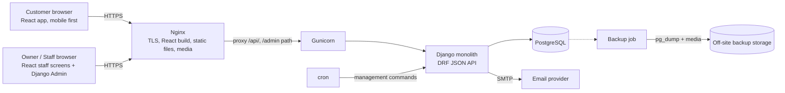
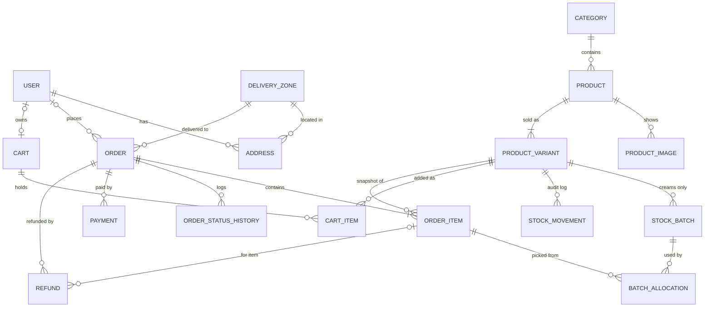
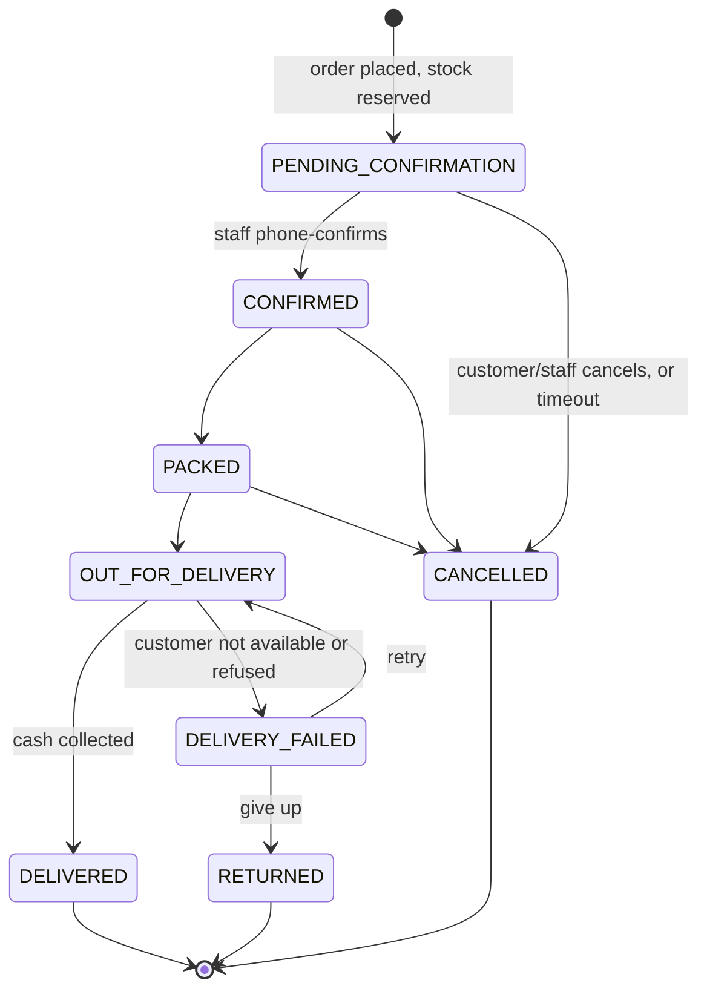
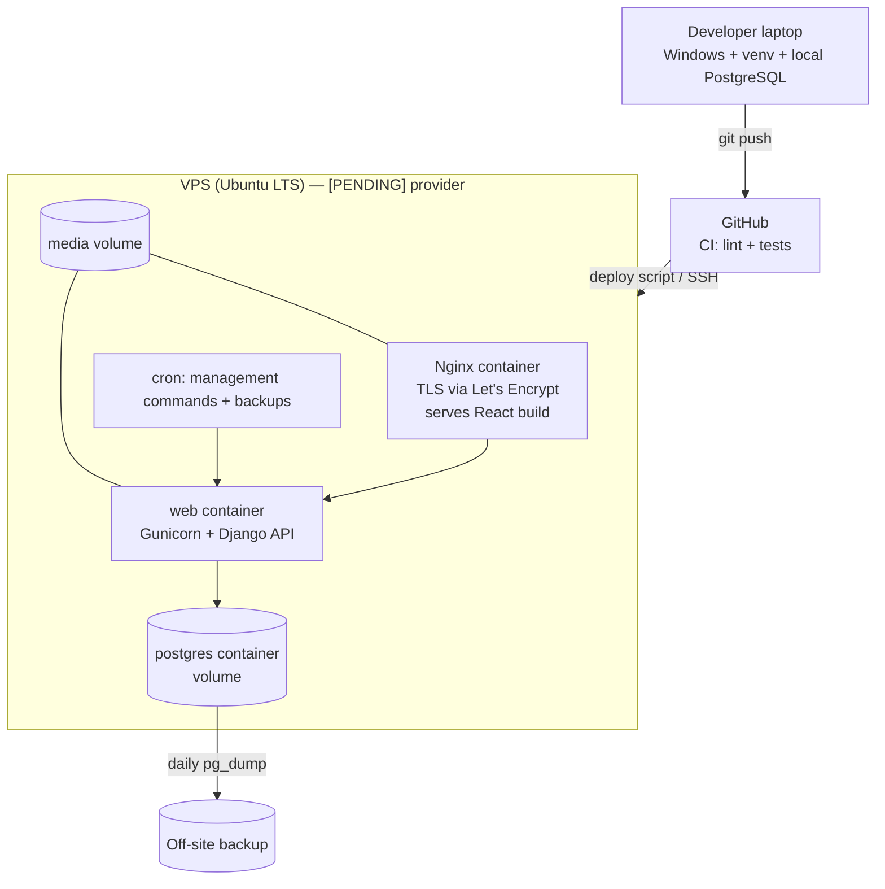

# ALAKBARTRADERS — Architecture

> **Status:** v0.2 (2026-10-28). Owner approved the drafts. Frontend changed to React (Q2). Final "APPROVED" comes after the Step 3 review.
> Items marked **[PENDING]** need a decision. Items marked **[RECOMMENDED]** are proposals not yet approved.

---

## 1. Overview

ALAKBARTRADERS is an online shop selling rice, dry fruits, and dairy creams to retail (B2C) customers in **Chashma** only.
Payment at launch is **Cash on Delivery (COD)** only. Delivery is done by the shop's own riders.

Scale at launch: about 100 customers per month (about 3–4 orders per day). The design is a single Django monolith on one server.
It must be correct and safe first; it does not need to be big.



**Why a monolith:** one codebase, one deploy, one database. At this scale, splitting into services adds network failures,
deploy complexity, and cost with zero benefit.

---

## 2. Tech stack

| Layer | Choice | Why |
|---|---|---|
| Language | Python 3.14 | Installed on the dev PC; the server gets the same version through `uv`. Pinned in `.python-version`. |
| Framework | Django 5.2 LTS (`django~=5.2`) | LTS = security fixes until April 2028 with fewer upgrades. Decided in Task 1.1. |
| Database | PostgreSQL 17 (same major version in dev and prod) | Real transactions, row locking (`select_for_update`), full-text search, `CHECK` constraints. SQLite is not used, even in dev, so dev matches prod. |
| Frontend | **React + Vite** (owner decision, Q2 = B) | See 2.1 and 2.2. |
| Frontend language | TypeScript **[RECOMMENDED]** | Catches wrong API field names at build time. |
| API | Django REST Framework (DRF), JSON under `/api/v1/` | Standard Django API toolkit; serializers validate input. |
| Routing / data (frontend) | React Router + TanStack Query **[RECOMMENDED]** | Router for pages; Query caches API data and handles loading and error states. |
| CSS | Tailwind CSS through its Vite plugin | Brand colours as tokens (design.md §1.2). |
| JS toolchain | Node.js LTS + npm (dev and build only) | Node is not needed on the server at runtime if the SPA option (2.2) is kept. |
| Frontend tests | Vitest + React Testing Library | Same style as Jest; fast with Vite. |
| Static files | WhiteNoise in app, Nginx in front | Simple, cache-friendly. |
| Media (product photos) | Local disk on server, included in backups | Cheapest; at most a few hundred images. Can move to object storage later. |
| Email | Transactional SMTP provider (e.g. Brevo / Zoho / Amazon SES) **[PENDING]** | Free tiers cover our volume. Needs domain DNS (SPF, DKIM). |
| PDF invoices | WeasyPrint **[PENDING]** | HTML/CSS to PDF. Note: needs GTK libraries, which are easy on Linux/Docker and awkward on Windows. |
| Background jobs | **None at launch.** Emails are sent after commit inside the request; scheduled jobs use cron + Django management commands. | 3–4 orders per day does not justify Redis + Celery. Revisit if emails slow the checkout or volume grows. |
| Cache | Django database or local-memory cache | Redis not needed at launch. |
| Package manager | `uv` **[RECOMMENDED]** | Fast; lock file for reproducible installs. |
| Error tracking | Sentry (free tier) | Know about crashes before customers complain. |

### 2.1 Frontend approach — options

| Option | Pros | Cons |
|---|---|---|
| **A. Templates + HTMX + Tailwind** | One codebase; fast pages; good SEO by default; "add to cart" without full page reload; little JavaScript | Very rich client-side interactivity is harder |
| B. DRF API + React/Next.js | Reusable API for a future mobile app | Two codebases, two deploys, auth/CSRF more complex, about double the work |
| C. Templates + Bootstrap, no HTMX | Simplest | Full page reloads; generic look |

**Decision (2026-10-28): B, React.** The owner chose React over the recommended A. Accepted costs: a second codebase (`frontend/`), a JSON API layer, and extra SEO work. Gain: a reusable API for a future mobile app and a modern frontend skill set.

### 2.2 React architecture — sub-decisions

The backend design does not change: models, services, selectors, the state machine, and stock locking stay as written. Only the **delivery layer** changes. Django views return JSON (DRF) instead of HTML. React renders the pages.

| Topic | Options | Recommendation |
|---|---|---|
| Rendering | **(a) Vite SPA**, built to static files and served by Nginx. (b) Next.js with server rendering, which needs a Node server in production. | **(a) [RECOMMENDED].** One runtime on the server and a simpler deploy. SEO is handled by the next row. |
| SEO for product pages | **(a) Django serves the SPA `index.html` with per-page `<title>`, meta, Open Graph, and JSON-LD filled in.** (b) Prerender pages at build time. (c) No SEO work. | **(a) [RECOMMENDED].** Google and WhatsApp previews see real product data, and there is no second server. |
| Auth | **(a) Django session cookie + CSRF token, same domain.** (b) JWT tokens stored in the browser. | **(a) [RECOMMENDED].** Same domain means no CORS. An `HttpOnly` cookie cannot be read by injected JavaScript. Django's session auth is already built and tested. |
| Origins | **Same domain:** `/api/v1/` for the API and `/` for React. In dev, the Vite dev server proxies `/api` to `runserver`. | No CORS headers needed in dev or prod. |
| Staff screens | **(a) React routes under `/staff/`**, using the same API with permission checks. Django Admin stays for catalog and settings. | **(a) [RECOMMENDED].** |
| API docs | `drf-spectacular` (OpenAPI schema) **[RECOMMENDED]** | The TypeScript API types can be generated from the schema. |

**Rule:** a React component never decides prices, stock, or totals. It displays what the API returns. The server checks everything again (rules.md §7).

---

## 3. Django apps

All apps live under `apps/`. Each app owns its models; other apps call its **services** (writes) and **selectors** (reads), not its models directly, for anything with business rules.
Each app that exposes data has an `api/` package (`serializers.py`, `views.py`, `urls.py`). API views are thin: validate with a serializer, call a service or selector, return JSON.

| App | Responsibility | Launch? |
|---|---|---|
| `core` | Base models (timestamps), `SiteSettings` (shop-wide settings), phone utilities, home/about/contact/policy pages | Yes |
| `accounts` | Custom `User` (email login), profile, addresses, roles (Owner/Staff groups) | Yes |
| `catalog` | Category, Product, ProductVariant (pack size, SKU, price), images, search, filters | Yes |
| `inventory` | Stock quantity, cream batches + expiry (FEFO), stock movements (audit log), low-stock and expiry alerts | Yes |
| `cart` | Session/user cart, merge on login, price re-check | Yes |
| `orders` | Checkout, Order/OrderItem with price snapshot, status state machine, cancellation, refunds, PDF invoice | Yes |
| `shipping` | Chashma delivery zones, fees, free-shipping threshold, cream-allowed flag per zone | Yes |
| `payments` | Payment records (COD now); gateway adapters + webhooks later | Yes (COD) |
| `notifications` | Email templates and sending; later SMS/WhatsApp | Yes (email) |
| `dashboard` | Staff API: order queue, COD confirmation, stock and expiry alerts, sales report (screens are in React) | Yes |
| `promotions` | Coupons | Later |
| `reviews` | Product reviews and ratings | Later |
| `wishlist` | Saved products | Later |

**Admin split:** Django Admin (customised) is for the **owner** to manage catalog, inventory, zones, and settings.
The custom `dashboard` is for **daily operations** (orders, COD calls, dispatch). Reason: Django Admin is excellent at CRUD but poor at workflows.

---

## 4. Data model (ERD)



### 4.1 Models (key fields)

| Model | Key fields | Notes |
|---|---|---|
| `User` | email (login), first/last name, phone, is_staff | **Custom user from day one.** Changing it later is very painful. |
| `Address` | user, full_name, phone, zone, street/house, landmark, is_default | Chashma only, so the zone replaces city/province. |
| `DeliveryZone` | name (e.g. a colony or sector), fee, cream_allowed, is_active, sort_order | **[PENDING]** list of Chashma areas + fees. |
| `Category` | name, slug, parent (optional), is_active | Rice, Dry Fruits, Dairy Creams. |
| `Product` | category, name, slug, description, is_perishable, is_active | `is_perishable=True` turns on batch tracking. |
| `ProductVariant` | product, label ("5 kg"), weight_grams, sku (unique), price, compare_at_price, stock_quantity, low_stock_threshold, is_active | One row per pack size. `stock_quantity` is used for non-perishables. |
| `ProductImage` | product, image, alt_text, sort_order | `alt_text` for accessibility + SEO. |
| `StockBatch` | variant, batch_code, quantity_received, quantity_remaining, received_on, expiry_date | Creams only. Sellable stock = sum of `quantity_remaining` where expiry_date > today + cut-off days. |
| `StockMovement` | variant, batch (optional), change (+/-), reason (RECEIVED, SOLD, CANCELLED, RETURNED, EXPIRED, ADJUSTED), order (optional), user, created_at | Append-only. Answers "where did 3 bags go?" |
| `Cart` / `CartItem` | cart: user or session_key; item: variant, quantity | No price stored; price is always read live. |
| `Order` | number (e.g. `AKT-000123`), user (optional), customer name/phone/email, address snapshot, zone, subtotal, shipping_fee, total, currency="PKR", status, payment_method, refund_status, notes, placed_at | Address and totals are **copied** so later edits never change past orders. |
| `OrderItem` | order, variant (`PROTECT`), product_name, variant_label, sku, unit_price, quantity, line_total | Price **snapshot** at order time. |
| `BatchAllocation` | order_item, batch, quantity | Which cream batch each item came from (FEFO). Needed for recalls and returns. |
| `OrderStatusHistory` | order, from_status, to_status, user, note, created_at | Full audit trail. |
| `Payment` | order, method (COD), amount, status (PENDING, COLLECTED, FAILED), collected_by, collected_at, reference | Online gateways later add provider fields + a unique `provider_txn_id`. |
| `Refund` | order, order_item (optional), amount, reason, method (cash / bank transfer), processed_by, created_at | Supports partial refunds per item. |
| `BlockedPhone` | phone, reason, created_by | COD abuse control. |
| `SiteSettings` | free_shipping_threshold, max_cod_order_value, cream_expiry_cutoff_days, pending_order_timeout_hours, store contact info | Singleton (one row) so the owner can edit settings without a deploy. |

All money fields: `DecimalField(max_digits=12, decimal_places=2)`. Order stores `currency="PKR"` explicitly.

### 4.2 Relationship types used

- **ForeignKey (many-to-one):** many `ProductVariant`s belong to one `Product` (Basmati → 1 kg, 5 kg, 25 kg). The most common relationship.
- **OneToOne:** one `User` has at most one active `Cart`. It is a ForeignKey with a uniqueness rule.
- **ManyToMany:** not needed at launch. Later, `Wishlist` (a user saves many products; a product is saved by many users), modelled with an explicit "through" table so we can store `added_at`.
- **`on_delete` choices matter:** `OrderItem.variant` uses `PROTECT`, so you cannot delete a variant that appears in past orders; you deactivate it instead (`is_active=False`). `CartItem.variant` uses `CASCADE`.

---

## 5. Core workflows

### 5.1 Customer purchase (COD)

```mermaid
sequenceDiagram
    actor C as Customer
    participant W as Django
    participant DB as PostgreSQL
    actor S as Staff
    actor R as Rider

    C->>W: Browse, choose pack size, add to cart
    W->>DB: Save CartItem (no stock reserved)
    C->>W: Checkout (name, phone, zone, address)
    W->>W: Validate: phone format, not blocked, zone active,<br/>creams allowed in zone, total ≤ max COD
    W->>DB: BEGIN; lock variants (select_for_update)
    W->>DB: Check stock, deduct, allocate cream batches (FEFO)
    W->>DB: Create Order(PENDING_CONFIRMATION), OrderItems, Payment(PENDING)
    W->>DB: COMMIT
    W-->>C: Thank-you page + order number
    W->>C: Email confirmation (after commit)
    W->>S: Email "new order"
    S->>C: Phone call to confirm
    S->>W: Mark CONFIRMED (or CANCELLED: stock restored)
    S->>W: PACKED, then OUT_FOR_DELIVERY
    R->>C: Deliver, collect cash
    S->>W: Mark DELIVERED + Payment COLLECTED
    W->>C: Email "delivered"
```

### 5.2 Order status lifecycle (state machine)



Rules:
- Only transitions in this diagram are allowed. They are enforced in **one** service function (`orders.services.transition_order`). Views never set `order.status` directly.
- Every transition writes an `OrderStatusHistory` row.
- `CANCELLED` and `RETURNED` restore stock. For returned creams, staff choose "restock" or "write off" (because of cold-chain risk).
- Refunds are tracked separately with `refund_status` = NONE / PARTIAL / FULL. A COD refund only applies after cash was collected.
- Pending orders not confirmed within `pending_order_timeout_hours` are auto-cancelled by a cron job, which releases the stock.

### 5.3 Stock reservation and deduction

- **When:** stock is deducted at **order placement**, not when items are added to the cart. A cart is not a promise.
- **How:** inside `transaction.atomic()`, lock the variant rows with `select_for_update()` (always in sorted id order, which avoids deadlocks), re-check availability, deduct, and write `StockMovement` rows.
- **Creams (FEFO):** pick batches ordered by `expiry_date`, skipping batches inside the expiry cut-off, and record `BatchAllocation`s.
- **Why the lock:** two customers buying the last 25 kg bag at the same second must not both succeed.
- **Database guard:** a `CHECK (stock_quantity >= 0)` constraint is a second safety net.

### 5.4 Price changes while items sit in a cart

The cart never stores a price. At checkout the current price is shown. If a price changed since the item was added, the customer sees a notice before confirming.
`OrderItem` freezes the price at placement.

### 5.5 Cancellation and partial refund

```mermaid
flowchart TD
    A[Cancel request] --> B{Status?}
    B -->|PENDING / CONFIRMED / PACKED| C[transition to CANCELLED]
    C --> D[Restore stock + StockMovement CANCELLED]
    B -->|OUT_FOR_DELIVERY| E[Not cancellable: becomes DELIVERY_FAILED / RETURNED]
    B -->|DELIVERED| F[Refund flow]
    F --> G[Staff picks item(s) + amount]
    G --> H[Create Refund row, pay cash or bank transfer manually]
    H --> I[Update refund_status PARTIAL or FULL]
```

### 5.6 Payment webhooks (future: JazzCash / Easypaisa)

Design rules are written now so COD code does not block gateways later:
1. Webhook URL per provider: `/payments/webhook/<provider>/`.
2. **Verify** the signature/hash with the provider secret. Never trust the redirect URL alone.
3. **Idempotent:** `provider_txn_id` is unique; a repeated callback returns 200 and does nothing.
4. Lock the order row, check the amount matches, then update `Payment` and the order.
5. A reconciliation command asks the provider for the status of payments stuck in PENDING.

### 5.7 Scheduled jobs (cron + management commands)

| Command | Frequency | Purpose |
|---|---|---|
| `cancel_stale_orders` | hourly | Auto-cancel unconfirmed orders; release stock |
| `expiry_report` | daily 08:00 | Email staff the cream batches near expiry; mark expired batches |
| `low_stock_report` | daily 08:00 | Email staff the variants below threshold |
| `backup_db` | daily 02:00 | `pg_dump` + media, copied off-site |

---

## 6. URL map

The page URLs below are **React Router routes**. For each customer page route, Django returns `index.html` with that page's meta tags (see 2.2). React then loads data from the API.

### Customer

| URL | Page |
|---|---|
| `/` | Home |
| `/c/<category-slug>/` | Category listing with filters |
| `/p/<product-slug>/` | Product detail + pack-size selector |
| `/search/?q=` | Search results |
| `/cart/` | Cart |
| `/checkout/` | Checkout (guest or logged in) |
| `/order/<number>/thanks/` | Order placed |
| `/track/` | Track order (order number + phone) |
| `/accounts/login/`, `/accounts/signup/`, `/accounts/password-reset/` | Auth |
| `/account/`, `/account/orders/`, `/account/orders/<number>/`, `/account/addresses/` | Customer account |
| `/about/`, `/contact/`, `/delivery-areas/` | Info |
| `/policies/returns/`, `/policies/privacy/`, `/policies/terms/` | Policies |
| `/sitemap.xml`, `/robots.txt` | SEO |

### Staff and owner

| URL | Page | Who |
|---|---|---|
| `/staff/` | Dashboard home (today's orders, alerts) | Staff, Owner |
| `/staff/orders/` and `/staff/orders/<number>/` | Order queue, detail, status actions, invoice PDF | Staff, Owner |
| `/staff/stock/` | Low stock + expiry alerts, receive batch, adjust stock | Staff, Owner |
| `/staff/reports/` | Sales report | Owner |
| `/<secret-admin-path>/` | Django Admin (catalog, zones, settings, users) | Owner |

### API (`/api/v1/`, JSON, DRF)

| Endpoint | Methods | Who |
|---|---|---|
| `auth/csrf/`, `auth/login/`, `auth/logout/`, `auth/signup/`, `auth/password-reset/`, `auth/me/` | GET / POST | Anyone |
| `categories/`, `categories/<slug>/` | GET | Anyone |
| `products/?category=&q=&size=&min_price=&max_price=&in_stock=&ordering=&page=`, `products/<slug>/` | GET | Anyone |
| `cart/`, `cart/items/`, `cart/items/<id>/` | GET / POST / PATCH / DELETE | Session or user |
| `zones/` | GET | Anyone |
| `checkout/quote/` (fee + totals), `checkout/` (place order, idempotency token) | POST | Session or user |
| `orders/track/` (number + phone) | POST | Anyone, rate limited |
| `account/orders/`, `account/orders/<number>/`, `account/orders/<number>/invoice.pdf`, `account/addresses/` | GET / POST / PATCH / DELETE | Logged-in owner of the data |
| `staff/summary/`, `staff/orders/`, `staff/orders/<number>/`, `staff/orders/<number>/transition/`, `staff/stock/`, `staff/batches/`, `staff/blocked-phones/` | GET / POST | Staff, Owner |
| `staff/reports/sales/` (JSON + CSV) | GET | Owner |
| `schema/` (OpenAPI) | GET | Dev only, or staff in prod |

Errors use one JSON shape: `{"code": "out_of_stock", "message": "...", "fields": {...}}`. React shows `message`; tests check `code`.

---

## 7. Integrations

| Integration | Phase | Notes |
|---|---|---|
| Transactional email | 9 | SMTP via `django.core.mail`; SPF/DKIM/DMARC on the domain |
| Sentry | 12 | Error tracking |
| Uptime monitor (e.g. UptimeRobot) | 14 | Alert if the site is down |
| JazzCash / Easypaisa | Later (7b) | Merchant accounts required; webhook rules in 5.6 |
| WhatsApp / SMS | Later | Order updates; phone OTP login |
| Maps | Not planned | Zones are a dropdown list, not GPS |

---

## 8. Security

- **Auth:** Django auth, strong password validators, password reset by email. Staff must use strong passwords. 2FA for the owner is **[RECOMMENDED]** (`django-otp`).
- **Roles:** Django Groups: `Owner` and `Staff`, checked with permission decorators/mixins on every staff view. Staff cannot change prices, settings, or see reports.
- **CSRF:** session auth means CSRF protection is required. React reads the token from the `csrftoken` cookie (set by `auth/csrf/`) and sends it in the `X-CSRFToken` header on every POST/PATCH/DELETE.
- **CORS:** not enabled. The API and React share one domain.
- **XSS:** React escapes output by default. `dangerouslySetInnerHTML` is forbidden except for sanitised content. Session cookie is `HttpOnly`.
- **COD abuse:** phone validation (Pakistan mobile format), `BlockedPhone`, max COD value, phone confirmation before dispatch, rate limit on checkout.
- **Rate limiting:** login, signup, password reset, checkout, order tracking (`django-ratelimit` **[RECOMMENDED]**).
- **Secrets:** only in environment variables (`.env` in dev, never committed). `DEBUG=False` in prod.
- **HTTPS everywhere:** HSTS, secure cookies, `SECURE_PROXY_SSL_HEADER`.
- **Admin:** non-default URL path, staff-only, login rate limited.
- **Uploads:** images only; size limit; served by Nginx, never executed.
- **Order tracking privacy:** a lookup needs the order number **and** the phone number.
- **Dependency updates:** `pip-audit` / Dependabot.
- **Future payments:** signature verification + idempotency (5.6).

---

## 9. Deployment



| Environment | Where | Purpose |
|---|---|---|
| dev | Your Windows laptop | Daily work. `DEBUG=True`, local PostgreSQL. |
| staging | Optional: the same VPS, a separate compose project + subdomain | Test deploys before prod. **[PENDING]** keep or skip. |
| prod | VPS | Real shop |

- **Settings:** `config/settings/base.py`, `dev.py`, `prod.py`; all values that change between environments come from env vars.
- **No Docker** in dev or prod. The 1 GB server cannot spare the memory, and `systemd` services are simpler to run on one box.
- **Frontend build:** `npm ci && npm run build` runs on the developer PC (or in CI), and only `frontend/dist/` is uploaded to the server. Node is not installed on the running server.
- **Dev:** two terminals. In `backend/`: `uv run python manage.py runserver` (port 8000); in `frontend/`: and `npm run dev` (Vite, port 2004, proxies `/api` to 8000).
- **Backups:** daily database dump + media copied off-site, 14-day retention, **restore tested** before go-live.
- **Logging:** Django logging to stdout, collected by `journald` through systemd; Nginx access/error logs; Sentry for exceptions.
- **Monitoring:** uptime check + Sentry alerts + daily email reports from cron.
- **Hosting decision (2026-10-29):** option A, one self-managed budget VPS with 1 GB RAM (RackNerd or IONOS VPS XS, about $2–3/month). The owner maintains the server. The VPS is bought at Phase 14; Cloudflare Pages hosts the frontend preview until then.
- **1 GB adjustments:** no Docker on the server. Nginx, Gunicorn (2 workers) and PostgreSQL run as `systemd` services, 2 GB swap is enabled, and Postgres is tuned for low memory. Where the diagram above shows containers, read them as systemd services on the same host.

---

## 10. Open questions

| # | Question | Needed by |
|---|---|---|
| Q1 | ~~Django version~~ **Decided: 5.2 LTS** | — |
| Q2 | ~~Frontend option~~ **Decided: B, React** (2026-10-28) | — |
| Q12 | React sub-decisions in 2.2: Vite SPA, Django-filled meta for SEO, session auth, TypeScript (all recommended) | Step 3 review |
| Q3 | List of Chashma delivery zones + fee for each; which zones accept creams | Phase 8 |
| Q4 | Free-shipping threshold (PKR) | Phase 8 |
| Q5 | Max COD order value (PKR) | Phase 6 |
| Q6 | Cream expiry cut-off (days before expiry to stop selling) | Phase 4 |
| Q7 | Pending-order timeout (hours) | Phase 6 |
| Q8 | Email provider | Phase 9 |
| Q9 | Staging environment: keep or skip | Phase 14 |
| Q10 | ~~Hosting provider~~ **Decided: budget 1 GB VPS, self-managed, no Docker in prod** (2026-10-29) | — |
| Q11 | Logo and product photos (owner will share). **Colours decided** 2026-10-28 (design.md §1.2) | Phase 3 / design |
